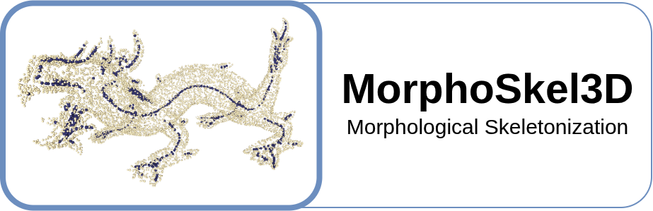

<p align="center">
  <picture>
    <source media="(prefers-color-scheme: dark)" srcset="assets/logo_dark.png">
    
  </picture>
</p>

<p align="center">
  <a href="https://pierreoo.github.io/">Pierre&nbsp;Onghena</a>&emsp;
  <a href="https://people.cmm.minesparis.psl.eu/users/velasco/">Santiago&nbsp;Velasco&#8209;Forero</a>&emsp;
  <a href="https://www.minesparis.psl.eu/en/annuaire-de-la-recherche/chercheur/beatriz-marcotegui-2/">Beatriz&nbsp;Marcotegui</a>
  <br><br>
  <a href="https://pierreoo.github.io/projects/morphoskel3d/"></a>
  <a href="https://arxiv.org/abs/2501.12974"></a>
  <a href="https://drive.google.com/drive/folders/1n7AdNwgjQS8XOvmVVuXuVT2pQybz3RXr?usp=sharing"></a>
  <a href="https://3dvconf.github.io/2025/"></a>
</p>

**MorphoSkel3D** is based on morphology to facilitate an efficient skeletonization of shapes.

This repository includes the methods as introduced in **MorphoSkel3D: Morphological Skeletonization of 3D Point Clouds for Informed Sampling in Object Classification and Retrieval**.


## <br>Installation

To clone this repository with its submodule of [Skeleton-Aware-Sampling](https://github.com/Pierreoo/Skeleton-Aware-Sampling/tree/9218dfb1626185d633610b34fd0684816194cbea):
```bash
git clone --recursive https://github.com/Pierreoo/MorphoSkel3D.git
```


## <br>Datasets

Place the dataset content under the [`data/shapenet`](data/shapenet) and [`data/modelnet`](data/modelnet) directories.

- [ShapeNet](https://github.com/clinplayer/Point2Skeleton): point clouds and ground-truth medial axes as prepared by Point2Skeleton.
- [ModelNet](https://github.com/charlesq34/pointnet2): normal-resampled point cloud version distributed by PointNet++.


## <br>Skeletonization

The pre-processed skeletons and meshes are available for download via [Skeletons](https://drive.google.com/drive/folders/1YAVtLBOUctmh3xajZWAL-yXDgAx0G_vV?usp=drive_link).  
Place the *shapenet* and *modelnet* content under the `data` directory.

The **ShapeNet** skeletons can be regenerated from the provided meshes for a specific category:
```bash
python evaluation/shapenet_time.py --category Airplane --tag Demo
```

The **ModelNet** skeletons can be generated from scratch:
```bash
python method/modelnet_MS3D.py --tag Demo
```


## <br>Quick Start

### Pre-trained models

The pre-trained models for the four sampling ratios are available via [Models](https://drive.google.com/drive/folders/1qjg_GsQ6P_Ibm8T-oxujnOctc_CuqJHA?usp=drive_link).  
Place the *log* content under the `Skeleton-Aware-Sampling/sampling/log` directory.


### Reconstruction Error

The reconstruction error from skeletal spheres:
```bash
python evaluation/shapenet_recon.py --category Airplane --evaluation recon --distance chamfer
```


### Object Classification

The classification accuracy under a sampling ratio:
```bash
cd Skeleton-Aware-Sampling
python classifi.py --test --ratio 64
```


### Point Cloud Retrieval

The retrieval mAP under a sampling ratio:
```bash
cd Skeleton-Aware-Sampling
python retrieval.py --ratio 64
```


## <br>License

<a href="https://github.com/Pierreoo/MorphoSkel3D/blob/main/LICENSE"></a>
<a href="https://github.com/Pierreoo/Skeleton-Aware-Sampling/blob/9218dfb1626185d633610b34fd0684816194cbea/LICENSE"></a>
<a href="https://github.com/Pierreoo/MorphoSkel3D/blob/main/reconstruction/PoNQ/LICENSE"></a>

The datasets listed above are not covered by these licenses and remain subject to their own terms.


## <br>Citation

If you find *MorphoSkel3D* useful to your research, please consider citing:
```bibtex
@inproceedings{onghena2025morphoskel3d,
  author    = {Onghena, Pierre and Velasco-Forero, Santiago and Marcotegui, Beatriz},
  booktitle = {2025 International Conference on 3D Vision (3DV)},
  title     = {{MorphoSkel3D}: Morphological Skeletonization of {3D} Point Clouds for Informed Sampling in Object Classification and Retrieval},
  year      = {2025},
  pages     = {1350--1359},
  publisher = {IEEE},
  doi       = {10.1109/3DV66043.2025.00128}
}
```
